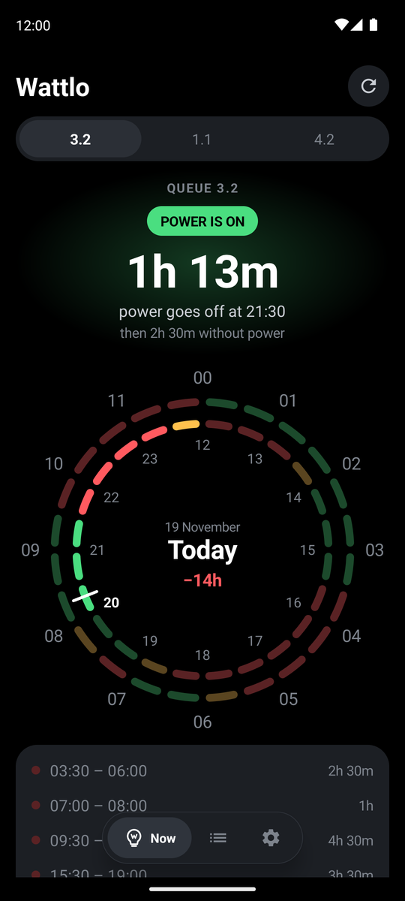
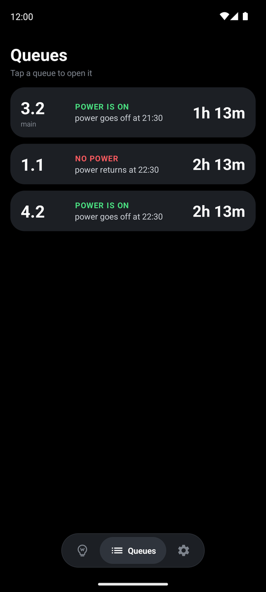
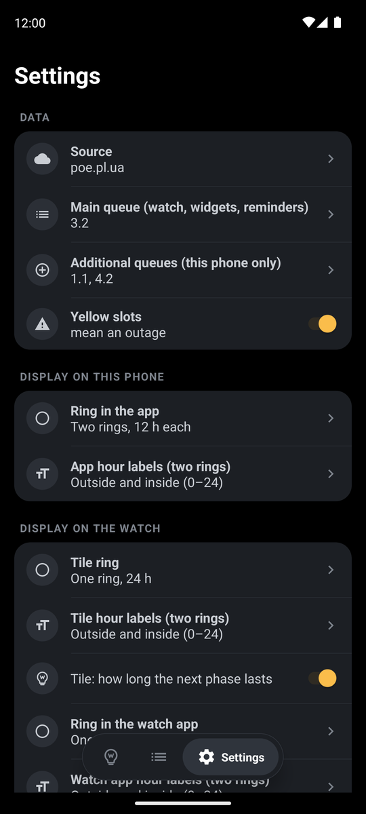
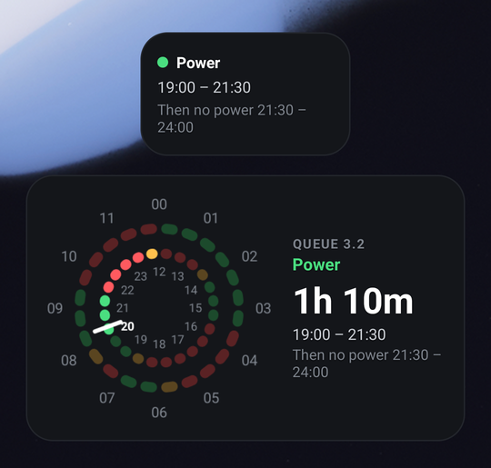
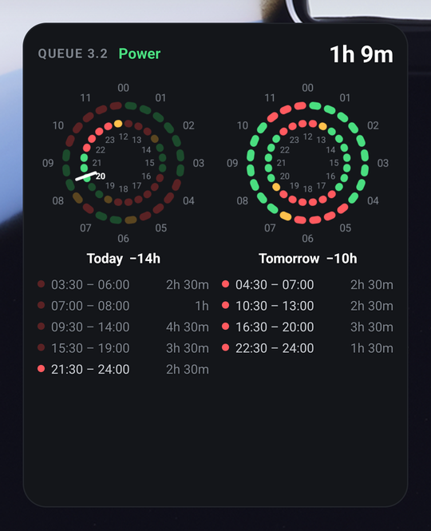
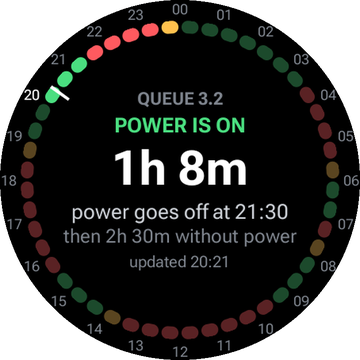
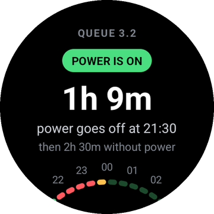

<p align="center">
  
</p>

<h1 align="center">Wattlo</h1>

<p align="center">
  The power outage schedule on a Wear OS watch and on an Android phone:<br>
  is the power on now, how long until it changes, and what comes next.
</p>

<p align="center">
  <a href="README.md">Українська</a> · English
</p>

The app has two parts that work together and on their own:

- **for the watch (Wear OS)**: a tile, a watch face complication and the app itself; it works without a phone too;
- **for the phone (Android)**: a main screen with the day ring, several queues, home screen widgets and settings, including how the app looks on the watch.

**Tested on the watches:** Galaxy Watch4 Classic and Galaxy Watch Ultra 2. It should work on other Wear OS 3+ watches as well. The phone app (Android 8.0+) has so far only been tested on an emulator; testing on real phones is still ahead.

> **Status: beta (1.0.0-beta).** The app is not on Google Play yet; it is installed from a computer (see "Installation").

## Screenshots

**Phone**: "Now", "Queues", "Settings":

<p>
  
  
  
</p>

**Widgets**: the state, the state with a ring, today and tomorrow:

<p>
  
  
</p>

**Watch**: the tile and the app:

<p>
  
  
</p>

The screenshots were taken on emulators (a Pixel 8 with Android 14 and a Wear OS watch).

## Features

**Watch**
- **Tile**: the state, the countdown, the time of the next change, a ring or a strip of the coming hours.
- **Complication** for the watch face: `ON 4:53` / `OFF 0:37`, a progress arc; a small and a long variant.
- **App**: the outages for today and tomorrow, a choice of the source and the queue.
- The countdown is calculated by the watch itself; the data is refreshed in the background every 30 minutes.
- Reminders a few minutes before the power goes off and comes back, quiet hours, notifications about schedule changes.

**Phone**
- **Now**: the state and the countdown, the day ring (one ring of 24 hours or two of 12), the list of outages for today and tomorrow.
- **Queues**: the main queue (the one the watch, the widgets and the reminders use) and up to 11 extra ones, to see the state of several queues at once.
- **Widgets**: three sizes: the state, the state with a ring, today and tomorrow. Each widget has its own settings: the queue, the background (dark, tinted by the state, transparent) with an opacity slider, the rings and the hour numbers.
- **Settings**: the source, the queue, the rule for yellow slots, notifications, and also how the tile and the app look on the watch.
- The settings shared by the watch and the phone are synchronised between them; each device downloads the schedule itself.
- Languages: Ukrainian, Russian, English.

## Sources

Poltava region, queues 1.1–6.2:
- [poe.pl.ua](https://www.poe.pl.ua/disconnection/power-outages/): the official schedule of Poltavaoblenergo, 30-minute step, yellow for the switching time *(the default)*;
- [bezsvitla.com.ua](https://bezsvitla.com.ua/poltavska-oblast);
- [energy-ua.info](https://energy-ua.info).

The schedule can change at any time, so also follow the official announcements of the regional power company. The app is unofficial and is not affiliated with Ukrenergo or any regional power company.

## Installation

While the app is not on Google Play, it is installed from a computer through ADB (the watch over Wi-Fi). Both parts have the same package, `app.wattlo`, and the same signing key, so install them built on one computer (see "Building").

### 1. ADB on the computer
You need the [Android SDK Platform-Tools](https://developer.android.com/tools/releases/platform-tools) (or Android Studio).

### 2. The watch
1. *Settings → About watch → Software information* → tap **Software version** 5 times: *Developer options* appear.
2. *Developer options* → turn on **ADB debugging** and **Wireless debugging**.
3. The watch has to be on the same Wi-Fi network as the computer (if it is on Bluetooth through the phone, turn Wi-Fi on by hand).
4. Pairing (once): *Wireless debugging → Pair new device*: the watch shows an IP:port and a code:
   ```bash
   adb pair 192.168.x.x:PAIRING_PORT CODE
   ```
   After `Successfully paired` the watch usually connects by itself. Check with `adb devices`. If it is not listed, connect to the address on the main screen of *Wireless debugging* (the port differs from the pairing one): `adb connect 192.168.x.x:PORT`.
5. Install:
   ```bash
   adb install -r app/build/outputs/apk/release/app-release.apk
   ```
   If several devices are connected, add `-s <address from adb devices>`.

After installing, it is better to turn wireless debugging off: it drains the battery.

### 3. The phone
Turn on *Developer options → USB debugging* on the phone, connect it with a cable and run:
```bash
adb install -r phone/build/outputs/apk/release/phone-release.apk
```

### 4. Set it up
- Open **Wattlo** in the app list and choose the source and your queue (on the watch at the bottom, on the phone in the "Settings" tab).
- **Tile:** swipe to the end of the tiles → "+" → *Wattlo*.
- **Complication:** press and hold the watch face → *Customize* → a slot → *Wattlo*.
- **Widgets:** press and hold an empty spot on the phone home screen → *Widgets* → *Wattlo*.
- If the data lags behind: *Settings → Apps → Wattlo → Battery* → remove the restrictions (on Xiaomi, Huawei and Oppo also allow autostart).

## Building

Android SDK 35 (platform `android-35`). Gradle runs on JDK 21: the version is recorded in `gradle/gradle-daemon-jvm.properties` and Gradle downloads it itself on the first build:
```bash
./gradlew :app:assembleRelease :phone:assembleRelease
# → app/build/outputs/apk/release/app-release.apk     (watch)
# → phone/build/outputs/apk/release/phone-release.apk (phone)
./gradlew :core:testDebugUnitTest :app:testDebugUnitTest :phone:testDebugUnitTest
```
The release build goes through R8 and is signed with this computer's debug key. An APK built on another machine or in CI has a different signature and cannot be installed over an existing one: run `adb uninstall app.wattlo` first.

The version of both apps is set in `gradle.properties` (`appVersion`, `versionSuffix`), the build number is passed as `-PbuildNo=N`; the version code is calculated by `gradle/versioning.gradle.kts` (phone `101000000`, watch `201000000`).

## How it is built

| Module | File | What it does |
|---|---|---|
| `core` | `Schedule.kt` | parsers of the three sites, the state calculation (30-minute slots) |
| | `Data.kt` | sources, settings, the per-queue cache, background refresh (WorkManager) |
| | `SettingsSync.kt` | synchronises the shared settings between the watch and the phone (Wear OS Data Layer) |
| | `Notify.kt` | reminders and notifications about schedule changes |
| | `DialView.kt` | the day ring |
| `app` (watch) | `WattloTileService.kt` | the tile (ProtoLayout, a dynamic countdown) |
| | `WattloComplicationService.kt` | the complication with a timeline of changes and a dynamic `H:MM` |
| | `MainActivity.kt` | the app screen |
| `phone` | `MainActivity.kt`, `QueuesActivity.kt`, `SettingsActivity.kt` | the "Now", "Queues" and "Settings" tabs |
| | `Widgets.kt`, `WidgetRing.kt`, `WidgetConfigActivity.kt` | the widgets and their settings |

The icon (`store/ic_launcher_512.png` for Google Play) is drawn by `store/render_icons.py` with the same geometry as the vector drawables.

## Origin

Wattlo grew out of the watch app **"Svitlo"** by Yehor Shamanskyi, [sudoRM-rSLASH/Watch4Classic-Svitlo](https://github.com/sudoRM-rSLASH/Watch4Classic-Svitlo): the initial code base (the schedule parsers, the state calculation, the first tile and complication) comes from there. Many thanks to the author! The phone app, the widgets, the synchronisation, several queues and the new design were added later.

## License

[MIT](LICENSE). The copyright of the initial code belongs to Yehor Shamanskyi; his notice is kept in `LICENSE`. The licenses of the third-party libraries are in [THIRD_PARTY_NOTICES.md](THIRD_PARTY_NOTICES.md) (the app shows the same text: *Settings → Open-source licenses*; `tools/update_licenses.py` rebuilds the list).
