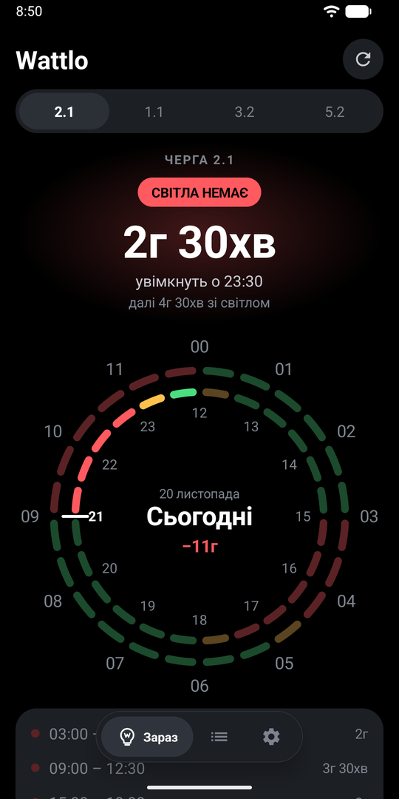
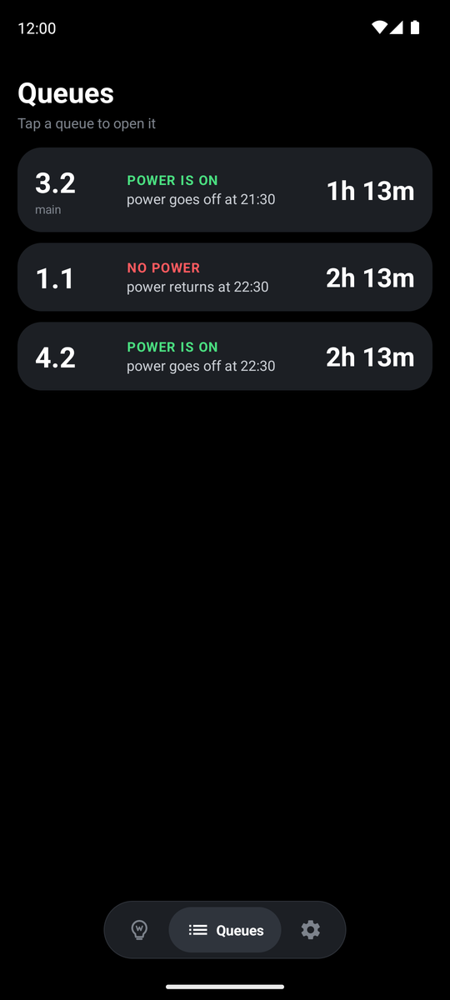
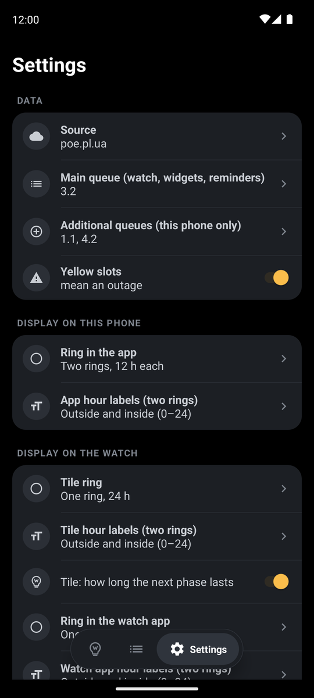
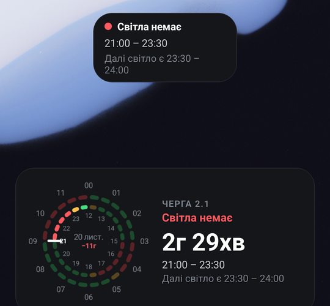
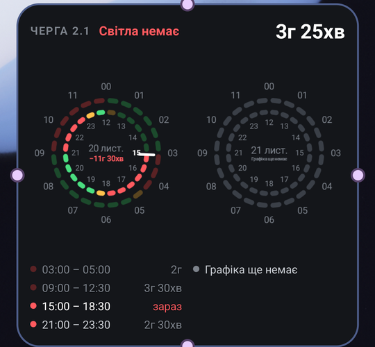
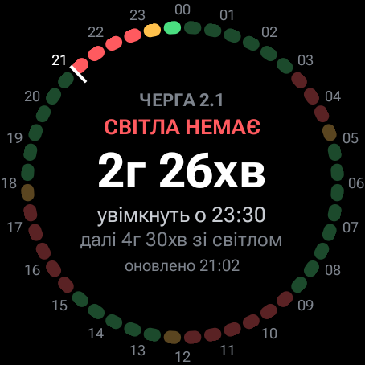
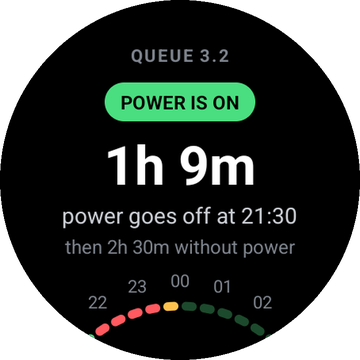

<p align="center">
  
</p>

<h1 align="center">Wattlo</h1>

<p align="center">
  Графік відключень світла на годиннику Wear OS і на телефоні Android:<br>
  чи є світло зараз, скільки лишилось до зміни і що буде далі.
</p>

<p align="center">
  Українська · <a href="README.en.md">English</a>
</p>

Застосунок складається з двох частин, які працюють разом і окремо:

- **для годинника (Wear OS)** — тайл, complication для циферблата і сам застосунок; працює й без телефона;
- **для телефона (Android)** — головний екран з кільцем доби, кілька черг, віджети на головному екрані, налаштування, у тому числі того, як виглядає застосунок на годиннику.

**Перевірялось на годинниках:** Galaxy Watch4 Classic і Galaxy Watch Ultra 2. Має працювати й на інших годинниках із Wear OS 3+. Застосунок для телефона (Android 8.0+) поки перевірений на емуляторі, на реальних телефонах тестування попереду.

> **Статус: бета (1.0.0-beta).** У Google Play застосунку ще немає, ставиться з комп'ютера (див. «Встановлення»).

## Скріншоти

**Телефон** — «Зараз», «Черги», «Налаштування»:

<p>
  
  
  
</p>

**Віджети** — стан, стан із кільцем, сьогодні й завтра:

<p>
  
  
</p>

**Годинник** — тайл і застосунок:

<p>
  
  
</p>

Знімки зроблено на емуляторах (Pixel 8 з Android 14 і Wear OS).

## Що вміє

**Годинник**
- **Тайл** — стан, відлік, о котрій зміна, кільце або смужка найближчих годин.
- **Complication** для циферблата — `ON 4:53` / `OFF 0:37`, дуга прогресу; є маленький і довгий варіанти.
- **Застосунок** — відключення на сьогодні й завтра, вибір джерела і черги.
- Відлік рахує сам годинник, дані оновлюються у фоні кожні 30 хв.
- Нагадування за кілька хвилин до відключення і до включення, тихі години, сповіщення про зміну графіка.

**Телефон**
- **Зараз** — стан і відлік, кільце доби (одне на 24 години або два по 12), список відключень на сьогодні й завтра.
- **Черги** — основна черга (її показують годинник, віджети й нагадування) і до 11 додаткових, щоб бачити стан кількох черг одразу.
- **Віджети** — три розміри: стан, стан із кільцем, сьогодні й завтра. У кожного свої налаштування: черга, фон (темний, за станом, прозорий) з повзунком прозорості, кільця й підписи годин.
- **Налаштування** — регіон, джерело, черга, правило жовтих слотів, сповіщення, а також вигляд тайла й застосунку на годиннику.
- Налаштування, спільні для годинника й телефона, синхронізуються між ними; графік кожен пристрій завантажує сам.
- Мови: українська, російська, англійська.

## Джерела

Регіони: 21 область (Полтавська, Харківська, Дніпропетровська, Одеська, Київська, Львівська та інші; поки без Донецької, Луганської та Херсонської) і місто Київ (у Києва 60 підчерг, 1.1–60.1; у Тернопільської області 14 черг; у Чернівецької — 12 груп («Група 1…12» на сайті, у застосунку «Черга 1…12»); в інших — 12 черг, 1.1–6.2). Регіон обирається в майстрі налаштування і в налаштуваннях.
- [poe.pl.ua](https://www.poe.pl.ua/disconnection/power-outages/) — офіційний графік Полтаваобленерго, крок 30 хв, жовтим — час перемикання; лише для Полтавської області, там же *за замовчуванням*;
- [bezsvitla.com.ua](https://bezsvitla.com.ua) — графіки всіх регіонів, крок 30 хв. Сайт дозволяє використовувати матеріали з активним посиланням на нього: застосунок має його в «Налаштування → Джерела графіків».

Інші сайти з графіками (наприклад energy-ua.info) не використовуються: їхній `robots.txt` забороняє автоматичне читання.

Графік може змінитися будь-коли — орієнтуйтеся також на офіційні оголошення обленерго. Аварійні й екстрені відключення в графіках зазвичай не відображаються, тож застосунок про них не знає. Застосунок неофіційний і не пов'язаний ні з Укренерго, ні з обленерго.

## Встановлення

Поки застосунку немає в Google Play, його ставлять з комп'ютера через ADB (годинник — по Wi-Fi). Обидві частини мають однаковий пакет `app.wattlo` і ключ підпису, тому ставте їх зібраними на одному комп'ютері (див. «Збірка»).

### 1. ADB на комп'ютері
Потрібні [Android SDK Platform-Tools](https://developer.android.com/tools/releases/platform-tools) (або Android Studio).

### 2. Годинник
1. *Налаштування → Про годинник → Програмне забезпечення* → 5 разів натиснути **Версія ПЗ** — з'являться *Параметри розробника*.
2. *Параметри розробника* → увімкнути **Налагодження ADB** і **Бездротове налагодження**.
3. Годинник має бути в тій самій Wi-Fi мережі, що й комп'ютер (якщо він сидить на Bluetooth від телефона — увімкнути Wi-Fi вручну).
4. Пара (один раз): *Бездротове налагодження → Створити пару з новим пристроєм* — годинник покаже IP:порт і код:
   ```bash
   adb pair 192.168.x.x:ПОРТ_ПАРИ КОД
   ```
   Після `Successfully paired` годинник зазвичай підключається сам. Перевірити: `adb devices`. Якщо його там немає — підключитись за адресою з головного екрана *Бездротового налагодження* (порт інший, ніж для пари): `adb connect 192.168.x.x:ПОРТ`.
5. Встановити:
   ```bash
   adb install -r app/build/outputs/apk/release/app-release.apk
   ```
   Якщо підключено кілька пристроїв — додати `-s <адреса з adb devices>`.

Після встановлення бездротове налагодження краще вимкнути — воно садить батарею.

### 3. Телефон
Увімкнути на телефоні *Параметри розробника → Налагодження USB*, підключити кабелем і:
```bash
adb install -r phone/build/outputs/apk/release/phone-release.apk
```

### 4. Налаштувати
- Відкрити **Wattlo** у списку програм → вибрати регіон, джерело і свою чергу (на годиннику внизу, на телефоні — вкладка «Налаштування»).
- **Тайл:** гортати тайли до кінця → «+» → *Wattlo*.
- **Complication:** затиснути циферблат → *Налаштувати* → слот → *Wattlo*.
- **Віджети:** затиснути порожнє місце на головному екрані телефона → *Віджети* → *Wattlo*.
- Якщо дані відстають: *Налаштування → Програми → Wattlo → Акумулятор* → зняти обмеження (на Xiaomi, Huawei, Oppo ще й дозволити автозапуск).

## Збірка

Android SDK 35 (platform `android-35`). Gradle запускається на JDK 21: версія записана в `gradle/gradle-daemon-jvm.properties`, і Gradle сам завантажує її при першій збірці:
```bash
./gradlew :app:assembleRelease :phone:assembleRelease
# → app/build/outputs/apk/release/app-release.apk     (годинник)
# → phone/build/outputs/apk/release/phone-release.apk (телефон)
./gradlew :core:testDebugUnitTest :app:testDebugUnitTest :phone:testDebugUnitTest
```
Release-збірка проходить через R8 і підписана debug-ключем цього комп'ютера. APK, зібраний на іншій машині чи в CI, має інший підпис, тож поверх уже встановленого він не стане: спершу `adb uninstall app.wattlo`.

Версія обох застосунків задана в `gradle.properties` (`appVersion`, `versionSuffix`), номер збірки передається як `-PbuildNo=N`; код версії рахує `gradle/versioning.gradle.kts` (телефон `101000000`, годинник `201000000`).

## Як це влаштовано

| Модуль | Файл | Що робить |
|---|---|---|
| `core` | `Schedule.kt` | парсери трьох сайтів, розрахунок стану (слоти по 30 хв) |
| | `Data.kt` | джерела, налаштування, кеш по чергах, фонове оновлення (WorkManager) |
| | `SettingsSync.kt` | синхронізація спільних налаштувань між годинником і телефоном (Wear OS Data Layer) |
| | `Notify.kt` | нагадування і сповіщення про зміни графіка |
| | `DialView.kt` | кільце доби |
| `app` (годинник) | `WattloTileService.kt` | тайл (ProtoLayout, динамічний відлік) |
| | `WattloComplicationService.kt` | complication з таймлайном змін і динамічним `H:MM` |
| | `MainActivity.kt` | екран застосунку |
| `phone` | `MainActivity.kt`, `QueuesActivity.kt`, `SettingsActivity.kt` | вкладки «Зараз», «Черги», «Налаштування» |
| | `Widgets.kt`, `WidgetRing.kt`, `WidgetConfigActivity.kt` | віджети та їхні налаштування |

Іконку (`store/ic_launcher_512.png` для Google Play) малює `store/render_icons.py` за тією самою геометрією, що й векторні файли.

## Походження

Wattlo виріс із застосунку для годинника **«Світло»** Yehor Shamanskyi — [sudoRM-rSLASH/Watch4Classic-Svitlo](https://github.com/sudoRM-rSLASH/Watch4Classic-Svitlo): звідти початкова кодова база (парсери графіків, розрахунок стану, перший тайл і complication). Подяка авторові! Застосунок для телефона, віджети, синхронізація, кілька черг і нове оформлення додані пізніше.

## Ліцензія

[MIT](LICENSE). Авторське право на початковий код належить Yehor Shamanskyi, його повідомлення збережене в `LICENSE`. Ліцензії сторонніх бібліотек — у [THIRD_PARTY_NOTICES.md](THIRD_PARTY_NOTICES.md) (той самий текст показує застосунок: *Налаштування → Ліцензії відкритого ПЗ*; список оновлює `tools/update_licenses.py`).
